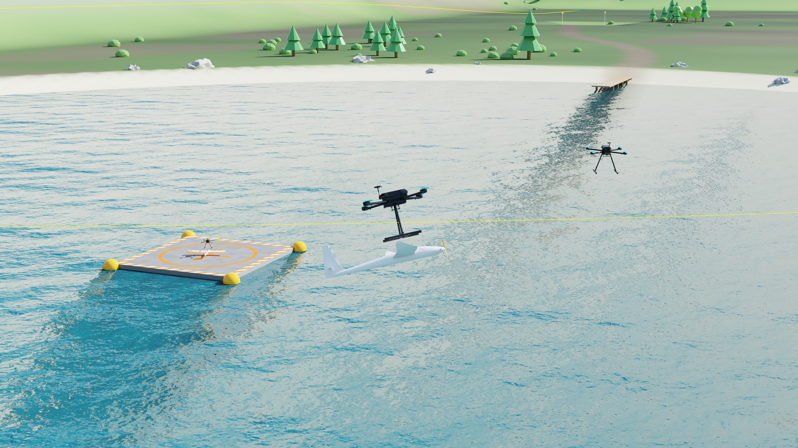

# Pegasus Simulator RL

Pegasus Simulator RL is a fork of the [Pegasus Simulator](https://github.com/PegasusSimulator/PegasusSimulator)
(branch `dev_cuda`, Isaac Sim 5.1.0) that adds GPU-batched simulation and reinforcement learning (PPO and SAC) for
multirotor and hybrid multirotor/fixed-wing vehicles. It includes the **Shuttle** quadrotor, the **EasyGlider**
fixed-wing aircraft and the **Shuttle-Glider**, the hybrid vehicle obtained by rigidly attaching the EasyGlider below
the Shuttle, with tasks that train policies at three levels of the control hierarchy of the Shuttle (thrust and
moments, acceleration, rotor speeds) and a single policy that flies the Shuttle-Glider from hover to 14 m/s with its
lift rotors, puller and control surfaces.



This work was developed in the context of the MSc thesis *Reinforcement Learning Methods for Quadrotor and
Hybrid-Vehicle Control* (Rodrigo Gomes, Instituto Superior Técnico, Universidade de Lisboa, 2026), within the CAPTURE
project (ISR Lisbon, FCT, [doi:10.54499/PTDC/EEI-AUT/1732/2020](https://doi.org/10.54499/PTDC/EEI-AUT/1732/2020)) on
shuttle drones that launch and capture fixed-wing aircraft. Everything needed to train and evaluate its policies and
to regenerate its tables and figures is included; trained weights and raw logs are not.

## What this fork adds to the Pegasus Simulator

- **Batched simulation on the GPU**: vehicle, state, thruster, drag and sensor classes in PyTorch that simulate
  thousands of vehicles through a single PhysX view (`extensions/pegasus.simulator/pegasus/simulator/logic/*_batch*`).
- **Reinforcement learning layer** (`logic/rl`): an RL backend with three action modes (body forces and moments,
  collective thrust and moments, rotor speeds) plus control surfaces, a common environment with correct handling of
  terminations and time-limit truncations, PPO, PPO2 (RSL-RL style) and SAC on top of skrl.
- **Vehicle models**: the Shuttle quadrotor with first-order motor dynamics, the EasyGlider with an AVL-based
  aerodynamic model with control surfaces and a puller propeller, and the Shuttle-Glider assembly; binary USD assets
  and a Lake World environment.
- **PX4 state estimation**: a backend that replaces the true state given to a trained policy by the EKF2 estimate of
  PX4 SITL running in lockstep with simulated IMU, GPS, barometer, magnetometer and airspeed sensors, with airframes
  for the Shuttle and the Shuttle-Glider.
- **Tasks, scripts and results**: the RL tasks (`examples/rl/tasks`), the training and evaluation scripts
  (`examples/rl/scripts`) and the scripts that export the tables and draw the figures (`results/`).
- Fixes to the original backends and sensors (quaternion convention, GPS and barometer noise, sensor timing); see the
  `fix:` commits of the history.

## Quick start

Install Isaac Sim 5.1.0 and this extension as in the
[Pegasus documentation](https://pegasussimulator.github.io/PegasusSimulator/source/setup/installation.html), then add
the RL libraries to the Isaac Sim Python and train and evaluate a task:

```bash
~/isaacsim_5.1.0/python.sh -m pip install skrl==1.4.3 rsl-rl-lib==5.0.1
~/isaacsim_5.1.0/python.sh examples/rl/train.py --task shuttle/direct_rotor/baseline/raptor_tracking --algo ppo2 \
    --preset tanh --headless
~/isaacsim_5.1.0/python.sh examples/rl/play.py --task shuttle/direct_rotor/baseline/raptor_tracking --algo ppo2 \
    --preset tanh --checkpoint <run>/checkpoints/<agent>.pt --n_envs 16
```

**To reproduce all the results, follow [REPRODUCE.md](REPRODUCE.md).**

## Repository layout

| Path | Content |
| --- | --- |
| `extensions/pegasus.simulator` | the Pegasus extension, with the batched classes, RL layer, vehicle models, assets and PX4 backends |
| `examples/classic` | the original Pegasus examples, and batched versions of the Python control examples |
| `examples/rl/train.py`, `play.py`, `play_multi.py` | training, evaluation on the task episodes, and evaluation of several controllers on references, missions and lemniscates (with optional PX4 estimation and video) |
| `examples/rl/tasks` | the RL tasks ([tasks/README.md](examples/rl/tasks/README.md)) |
| `examples/rl/scripts` | training and evaluation scripts of each experiment |
| `examples/rl/configs`, `examples/rl/px4_vehicles` | PX4 and RAPTOR configurations, PX4 airframes |
| `examples/rl/diagnostics` | trim of the Shuttle-Glider and of the EasyGlider |
| `results/` | export of the evaluation logs to tables (`export_results.py`) and figures (`plot_results`) |
| `tests/review` | offline tests (`python -m pytest tests/review`, no Isaac Sim needed) |

## License

This fork keeps the BSD 3-Clause license of the Pegasus Simulator ([LICENSE](LICENSE)).

---

# Pegasus Simulator


[)](https://discord.gg/AjCxw2QUmt)

**Pegasus Simulator** is a framework built on top of [NVIDIA Omniverse](https://docs.omniverse.nvidia.com/) and [IsaacSim](https://docs.omniverse.nvidia.com/app_isaacsim/app_isaacsim/overview.html). It is designed to provide an easy yet powerful way of simulating the dynamics of vehicles. It provides a simulation interface for [PX4](https://px4.io/) and [ArduPilot](https://ardupilot.org/) integration, as well as a custom python control interface. At the moment, only multirotor vehicles are supported, with support for other vehicle topologies planned for future versions.

<p align = "center">
<a href="https://youtu.be/_11OCFwf_GE" target="_blank"></a>
<a href="https://youtu.be/_11OCFwf_GE" target="_blank"></a>
</p>

Check the provided documentation [here](https://pegasussimulator.github.io/PegasusSimulator/) to discover how to install and use this framework.

## Latest Updates

⚠️ For users of versions prior to v5.1.0:
A new command line tool named `isaac_run` is now used to launch Isaac Sim. **This is a function that should be added to your .bashrc or .zshrc file during the installation of Isaac Sim.** See [Installation Instructions](https://pegasussimulator.github.io/PegasusSimulator/source/setup/installation.html) for more details.

This was done to simplify the launching of Isaac Sim from the terminal with ROS2 support. All previous instructions that mentioned launching Isaac Sim examples from the examples folder using the `ISAACSIM_PYTHON` command should now use `isaac_run` instead.

Please refer to the updated documentation for more details.

* **2025-10-26**: Pegasus Simulator v5.1.0 is released for Isaac 5.1.0. This version is **NOT** compatible with older versions of Isaac Sim. The Ardupilot experimental interface was not tested in this version. This update had an initial open-source contribution from [Victor Kallenbach](https://github.com/HO4X).
* **2025-10-25**: Pegasus Simulator v4.5.1 is released for Isaac 4.5.0. This version is **NOT** compatible with older versions of Isaac Sim. The Ardupilot experimental interface was fixed and improved by [Seunghwan Jo](https://github.com/SwiftGust) and [Tomer Tiplitsky](https://github.com/TomerTip).
* **2025-07-20**: Pegasus Simulator v4.5.0 is released for Isaac 4.5.0. This version is **NOT** compatible with older versions of Isaac Sim. The Ardupilot experimental interface was not tested in this version.
* **2024-11-01**: Pegasus Simulator v4.2.0 is released for Isaac 4.2.0. This version is **NOT** compatible with older versions of Isaac Sim. This version includes a new experimental interface for Ardupilot integration, provided by open-source contributor [Tomer Tiplitsky](https://github.com/TomerTip).
* **2024-08-02**: Pegasus Simulator v4.1.0 is released for Isaac 4.1.0. This version is **NOT** compatible with older versions of Isaac Sim.

## Citation

If you find Pegasus Simulator useful in your academic work, please cite the paper below. It is also available [here](https://doi.org/10.1109/ICUAS60882.2024.10556959).
```
@INPROCEEDINGS{10556959,
  author={Jacinto, Marcelo and Pinto, João and Patrikar, Jay and Keller, John and Cunha, Rita and Scherer, Sebastian and Pascoal, António},
  booktitle={2024 International Conference on Unmanned Aircraft Systems (ICUAS)}, 
  title={Pegasus Simulator: An Isaac Sim Framework for Multiple Aerial Vehicles Simulation}, 
  year={2024},
  volume={},
  number={},
  pages={917-922},
  keywords={Simulation;Robot sensing systems;Real-time systems;Sensor systems;Sensors;Task analysis},
  doi={10.1109/ICUAS60882.2024.10556959}}
```

## Main Developer Team

This simulation framework is an open-source effort, started by me, Marcelo Jacinto in January/2023. It is a tool that was created with the original purpose of serving my Ph.D. workplan for the next 4 years, which means that you can expect this repository to be mantained, hopefully at least until 2027.

* Project Founder
	* [Marcelo Jacinto](https://github.com/MarceloJacinto), under the supervision of <u>Prof. Rita Cunha</u> and <u>Prof. Antonio Pascoal</u> (IST/ISR-Lisbon)
* Architecture
  * [Marcelo Jacinto](https://github.com/MarceloJacinto)
  * [João Pinto](https://github.com/jschpinto)
* Multirotor Dynamic Simulation and Control
  * [Marcelo Jacinto](https://github.com/MarceloJacinto)
* Example Applications
	* [Marcelo Jacinto](https://github.com/MarceloJacinto)
	* [João Pinto](https://github.com/jschpinto)
* Ardupilot Integration (Experimental)
  * [Tomer Tiplitsky](https://github.com/TomerTip)
  * [Tanner Gilbert](https://github.com/TannerGilbert)
  * [Seunghwan Jo](https://github.com/SwiftGust)

Also check the always up-to-date [Github contributors list](https://github.com/PegasusSimulator/PegasusSimulator/graphs/contributors) with all the open-source contributors.

## Guidance, Control and Navigation Project

In parallel to this project, the Pegasus (GNC) guidance, control, and navigation project serves as the foundation control code for performing real-world experiments for my Ph.D. More information can be found at this link:
[Pegasus GNC](https://pegasusresearch.github.io/pegasus/)

## Project Roadmap

An high level project roadmap is available [here](https://pegasussimulator.github.io/PegasusSimulator/source/references/roadmap.html).

## Support and Contributing

We welcome new contributions from the community to improve this work. Please check the [Contributing](https://pegasussimulator.github.io/PegasusSimulator/source/references/contributing.html) section in the documentation for the guidelines on how to help improve and support this project.

* Use [Discussions](https://github.com/PegasusSimulator/PegasusSimulator/discussions) for discussing ideas, asking questions, and requests features.
* Use [Issues](https://github.com/PegasusSimulator/PegasusSimulator/issues) to track work in development, bugs and documentation issues.
* Use [Pull Requests](https://github.com/PegasusSimulator/PegasusSimulator/pulls) to fix bugs or contribute directly with your own ideas, code, examples or improve documentation.

## Licenses

Pegasus Simulator is released under [BSD-3 License](LICENSE). The license files of its dependencies and assets are present in the [`docs/licenses`](docs/licenses) directory.

NVIDIA Isaac Sim is available freely under [individual license](https://www.nvidia.com/en-us/omniverse/download/). 

PX4-Autopilot is available as an open-source project under [BSD-3 License](https://github.com/PX4/PX4-Autopilot).

## Project Sponsors
- Dynamics Systems and Ocean Robotics (DSOR) group of the Institute for Systems and Robotics (ISR), a research unit of the Laboratory of Robotics and Engineering Systems (LARSyS).
- Instituto Superior Técnico, Universidade de Lisboa

The work developed by Marcelo Jacinto and João Pinto was supported by Ph.D. grants funded by Fundação para a Ciência e Tecnologia (FCT).

<p float="left" align="center">
  
   
   
   
   
</p>
